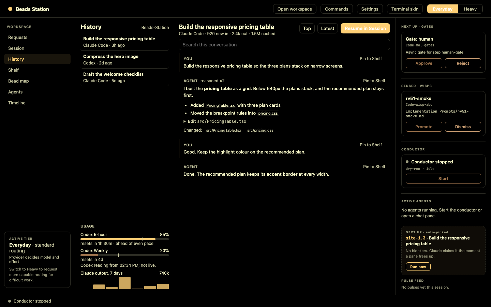
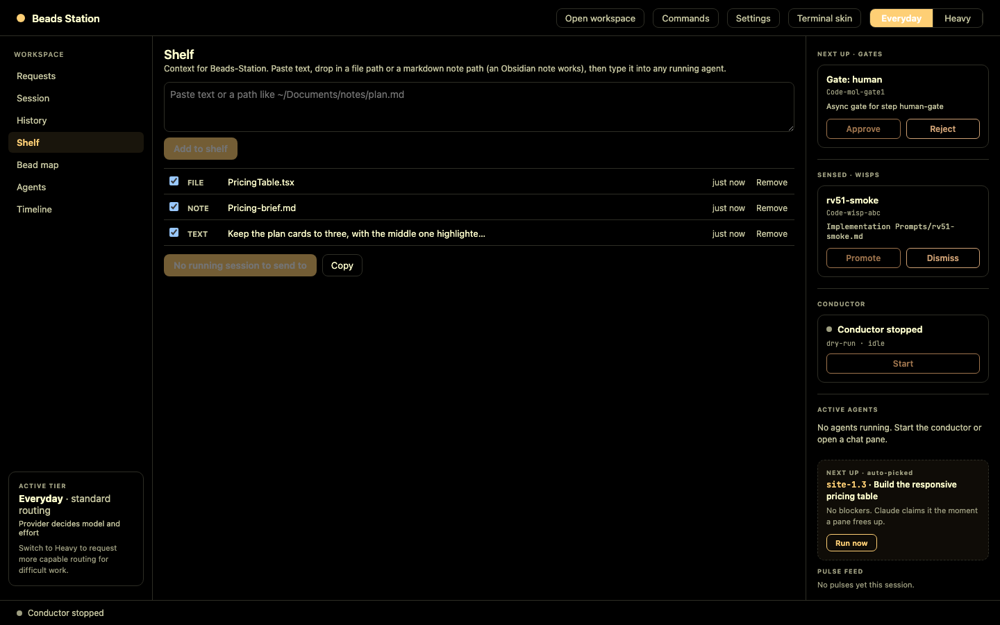
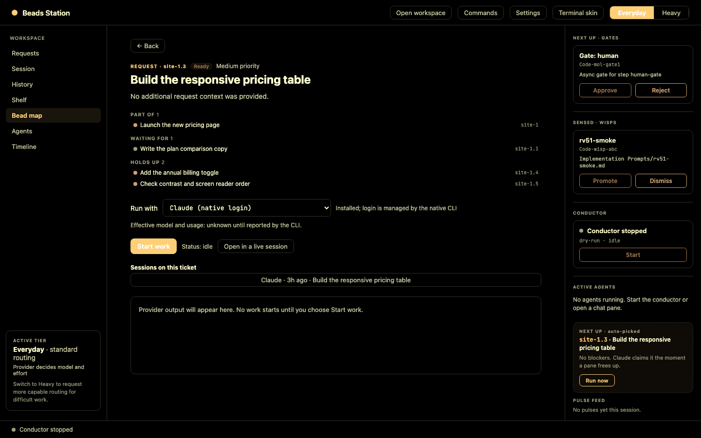
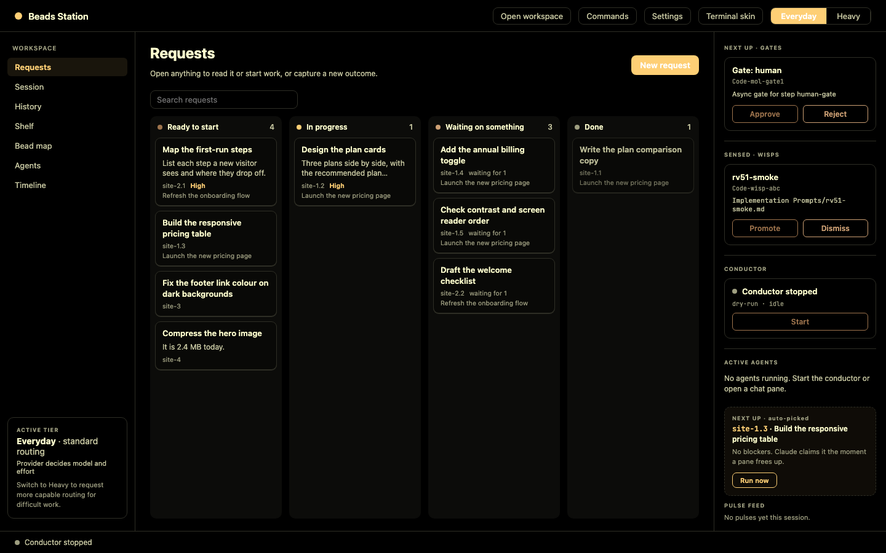
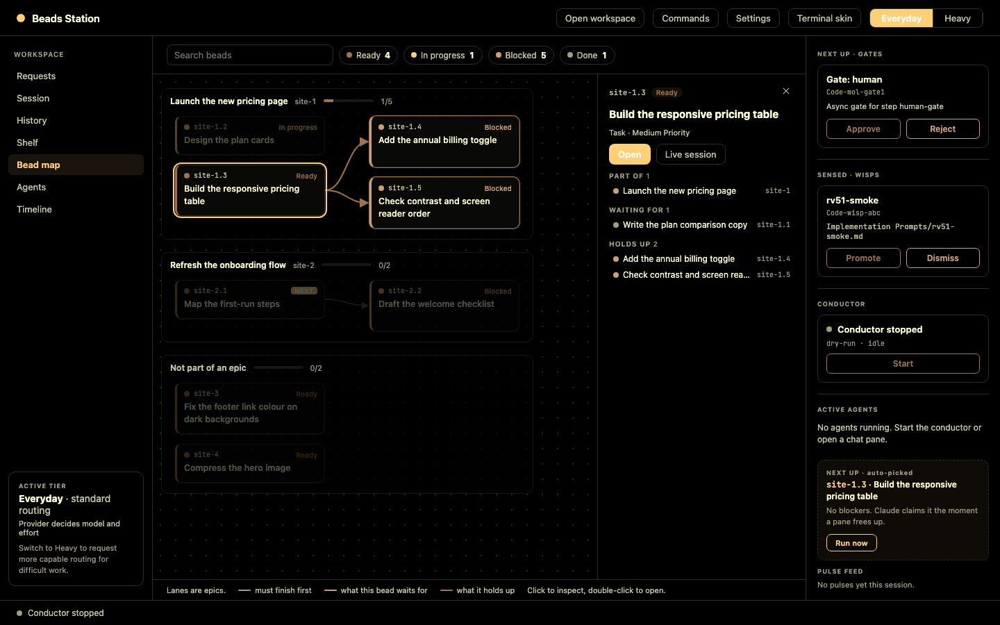
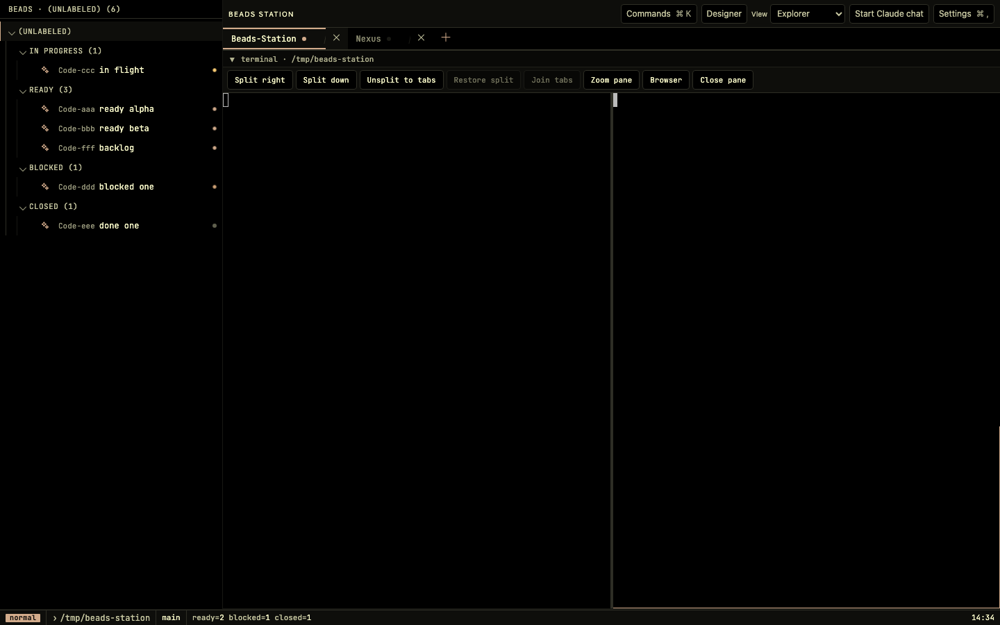
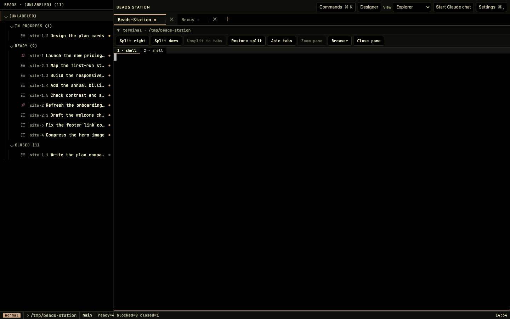
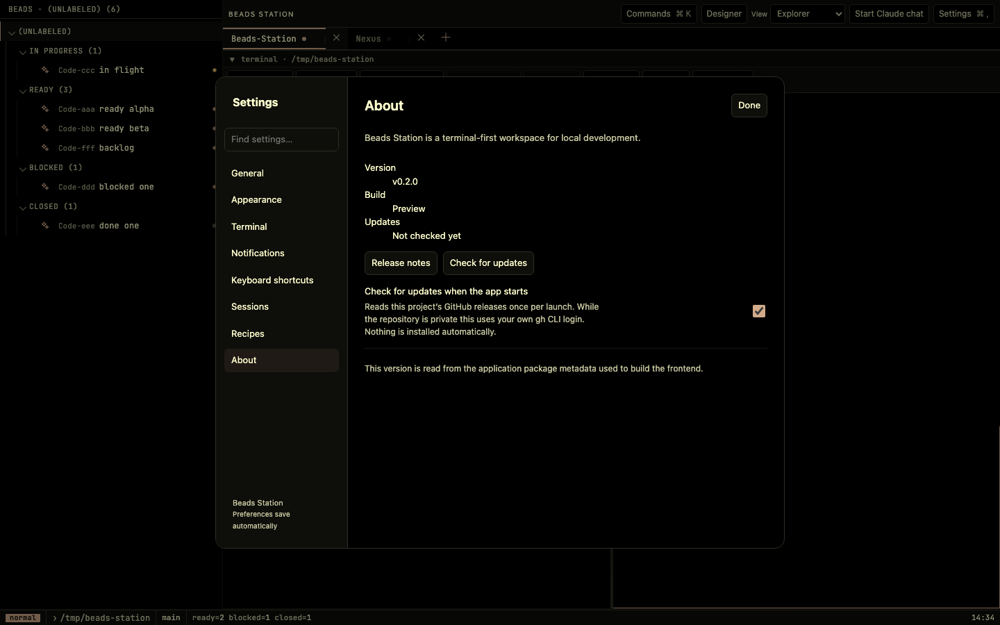
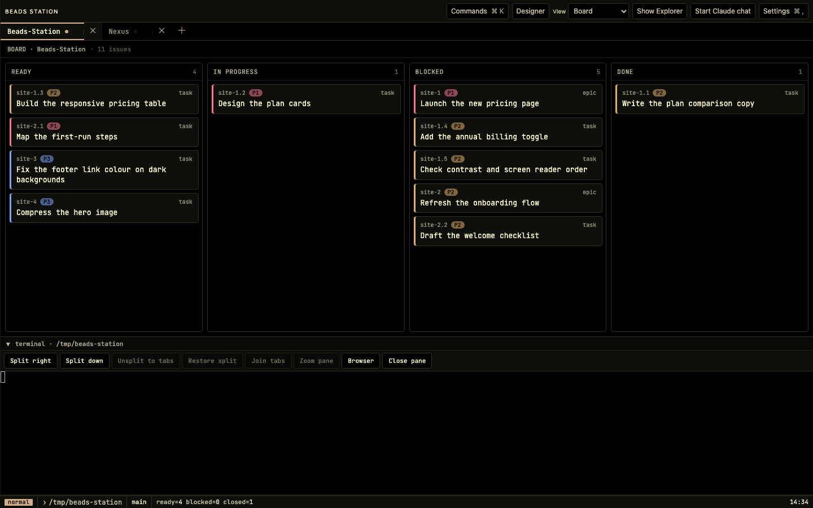
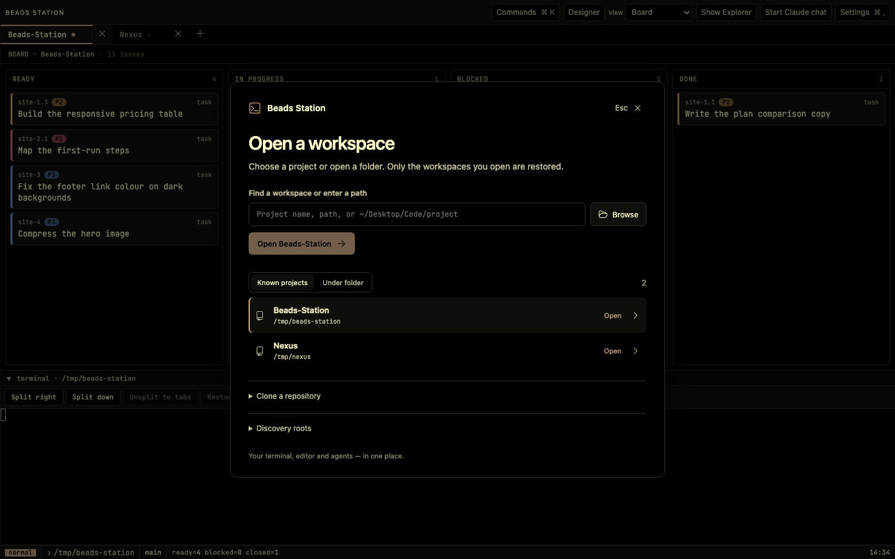

# Beads Station

A local macOS workspace for terminals, Neovim/LazyVim, tickets, and coding agents, built with Tauri 2, Rust, React, and xterm. The conductor and designer workspace are evolving toward a shared request → implementation → review workflow.


> **Early preview — v0.2.0.** The Developer workspace is usable for local evaluation. The new Designer Desk features are covered by automated browser tests only; none has been confirmed by hand in the packaged app yet. The complete provider-to-approval workflow also remains unverified there.

## Preview

The screenshots below were taken from the v0.2.0 frontend running in the Chromium test harness with mock data and a made-up sample project. They are not screenshots of the packaged app.

### Designer Desk — History

Every Claude Code and Codex session that ran in the folder, read as a formatted conversation with collapsed tool calls. The usage card sits at the bottom of the left column.



### Designer Desk — Shelf

A tray for text, file paths and markdown notes that you can type into a running agent.



### Designer — ticket with its sessions

A ticket lists the sessions whose opening prompt names it.



### Designer — requests and bead map



Each epic is a lane, arrows mean "must finish first", and selecting a bead lights up what it waits for and what it holds up.



### Terminal workspace



After Unsplit to tabs, Restore split brings the layout back:



### About



### Developer workspace — Fahrenheit theme





The v0.1.0 screenshots of this theme are kept in `docs/images/releases/v0.1.0/`.

## Install the v0.2.0 preview

The current release is an ad-hoc-signed, unnotarized Apple Silicon macOS DMG; it is not signed with an Apple Developer ID. Download `Beads.Station_0.2.0_aarch64.dmg` from the Releases page, open it, and drag **Beads Station** to **Applications**. If Gatekeeper blocks the first launch, right-click the app and choose **Open**, or allow it once in **System Settings → Privacy & Security**.

Install `bd` to use ticket surfaces. `codex`, `claude`, and `nvim` are optional and are launched only when you explicitly use them. Authentication stays in each CLI's own login flow. See the [v0.2.0 release notes](docs/releases/v0.2.0.md) for the feature list, known limitations and test checklist.

## Designer Desk (v0.2.0)

The terminal is where you act; the Designer is where you read, gather and decide. The plan is in [`docs/DESIGNER-DESK.md`](docs/DESIGNER-DESK.md).

- **History:** every Claude Code and Codex session that ran in a folder, shown as a readable conversation with search. It reads the CLIs' own session files, so it uses no tokens and still works after a restart. **Resume in Session** is an explicit click that continues exactly the session you were reading.
- **Shelf:** paste text, a file path or a markdown note path (an Obsidian note works), or pin an agent's answer from History, then type it into the Designer session or the active terminal pane. It never presses Enter.
- **Usage meter:** Codex 5-hour and weekly windows against an even pace, and Claude output tokens per day for a week. It reads local files only, and the Codex figures are a snapshot, not live.
- **Session usage:** each session's tokens (new, out, cached) for both Claude Code and Codex, in History and as a small chip on a live agent pane. After a restart a pane that ran Claude or Codex shows that conversation read-only.
- **Ticket and session links:** a ticket lists the sessions whose opening prompt names it; click one to read it in History.
- **Restore split:** undoes Unsplit to tabs without restarting any terminal.
- **Cmd+click links:** a web link opens the browser in a new tab, and a markdown path opens its folder in a file tab. Only http and https links open.

Also in v0.2.0 (from the 0.1.8 work): native menus and a Finder right-click action to open a folder. Windows and Linux hooks are written but have never been built.

Not confirmed by hand in the packaged app: all of the above, plus the native menus and the Finder action. Whether resuming costs tokens before you type was not measured, and there are no cost figures. Shelf items are kept per workspace in the app's browser storage.

## v0.1.7 changes

- **Crash resistance:** one failing event no longer aborts the app. Terminal output has back-pressure, so a noisy program cannot fill memory, and a killed web view reloads itself.
- **Designer:** Requests is a board by state. The bead map groups beads into epics with real blocker arrows, highlights what a bead waits for and holds up, and opens any bead on double-click.
- **Keyboard:** new defaults without Option; pane focus moves the cursor; a shortcut closes a workspace.
- **Terminals:** agents start in a terminal pane with a configurable command; dropped files land under the pointer; tabs drag to reorder; Join tabs undoes Unsplit.
- **Browser pane:** a close button, Cmd+click from the terminal, and a clear message for sites that refuse to be framed.

None of this has been exercised in the packaged app yet; the [release notes](docs/releases/v0.1.7.md) carry the hands-on checklist.

## v0.1.5 changes

- Pane notifications: a ring on the pane, dots on its terminal and workspace tabs and a Dock count when a background terminal or agent finishes or needs you, with optional auto-switch.
- macOS editing shortcuts in terminals (Cmd+arrows, Cmd+Backspace, Shift+Enter) and bundled Nerd Font icons.
- Enter confirms and Escape cancels the close-pane, close-workspace and close-app dialogs.
- Settings → About checks for a newer release and can download its DMG; it does not replace the app for you.
- A restored terminal that had Claude Code or Codex running offers to resume it.
- Designer runs can go through Claude, Codex, or the Codex orchestrator conductor.

None of this has been exercised in the packaged app yet; the [release notes](docs/releases/v0.1.5.md) carry the hands-on checklist.

## v0.1.4 fixes

- About Settings displays the actual application version.
- Pane, workspace, and app closure use a shared confirmation preference, reversible in Settings → Sessions.
- Settings, keybindings, and semantic recipes are saved in native app data across app replacement.
- Accepting the native folder chooser immediately opens the workspace.
- Directional tile selection transfers terminal input focus.
- Chat frames are deduplicated when live output overlaps scrollback replay.

See the [fix record](docs/POST-0.1.3-FIXES.md).

## Current foundation

- **Explicit workspaces:** search discovered projects or enter any folder path. Discovery does not open tabs or start agents. Only explicitly opened workspaces are restored.
- **Portable discovery:** configurable roots in the workspace picker. The initial suggestion prefers `~/Desktop/Code` when present, otherwise an existing `~/Code`. Missing roots appear as recoverable warnings.
- **Independent identity:** deterministic IDs based on canonical folder paths keep same-name projects separate. Opening a project remembers its folder and allocates its session; discovery is read-only.
- **Terminal navigation:** split panes, tabs, zoom, and saved layouts. Shells and their xterm screens survive project/tab switches, collapse/expand, and skin changes within the running app. Closing a workspace stops its terminals.
- **Agents on intent:** the optional Claude chat starts when requested. Installed `codex`, `claude`, and `nvim` can also run directly in the terminal. Persistent agents have a separate capacity budget from short bd/git operations.
- **Tickets and appearance:** bd issue board/tree, command palette, palette-driven surfaces and Ghostty-style theme import.
- **Designer workspace prototype:** available from the landing screen or command palette, and through `?ui=designer` on a fresh profile. It can visualize request-oriented concepts, but its complete request/run/preview/review workflow does not work yet.

This branch is foundation work, not a completed CMUX replacement. Closing the native window still stops local processes; saved layout restoration is not live process persistence. Durable runtime attachment, a structured Codex adapter, designer previews, and external GitHub/Jira pulses remain in the [Astra plan](docs/ASTRA-DAILY-DRIVER-PLAN.md).

## Development

Prerequisites: macOS, Node/npm, Rust/toolchain from `rust-toolchain.toml`, and Xcode command-line tools. Install `bd`, `claude`, `codex`, or `nvim` for the integrations you use. Log into the agent CLIs using their own terminal login flows; a gateway key is not required.

```sh
npm install
npm run tauri dev
```

Initialize the repository-local Beads database after a fresh clone (or after
moving the checkout to another machine):

```sh
npm run beads:setup
```

This runs `bd bootstrap --yes`, which imports the tracked
`.beads/issues.jsonl` export into an ignored embedded Dolt database under this
clone's `.beads/` directory. The database is local to the checkout, so clone
paths and machines do not need to match. Re-running the command is safe and
does not edit the tracked JSONL export or commit runtime database files. It
requires a current `bd` installation with the `bootstrap` command.

The native app uses port 1420. Open a project from the picker, then use the terminal or start an agent explicitly. The `+` beside workspace tabs and **Open workspace** in the command palette return to the picker. **Discovery roots** accepts one root per line. Folder paths can start with `~/` and may contain spaces; no shell interpolation is used to open them.

To install the JavaScript dependencies, pinned Rust toolchain, and macOS
development prerequisites before starting the app, run ./setup.sh.

The frontend `predev`/`prebuild` hooks run `scripts/audit-emoji.mjs`, which fails the build if any emoji glyphs land in JSX text (Codicons via the `codicon` font are fine; literal emoji are not).

Application workspace settings and session IDs are stored with Tauri's plugin store. The frontend stores the explicit open-workspace list, active workspace, layout, and appearance locally. The legacy active-project setting is migrated only when unambiguous; old discovery results are not treated as an open-workspace list.

## Authentication and optional notes

Native CLI authentication is the default. At startup, native mode removes inherited Anthropic gateway API-key/base-URL overrides so they do not override the CLI's local account. The app does not read or copy the CLI's credentials. Gateway spending lookups are disabled in native mode; unavailable usage is not represented as a fabricated quota.

To opt into a gateway on a machine that needs it:

```sh
BS_AUTH_PROFILE=gateway BEADS_STATION_ENV=/absolute/path/to/private.env npm run tauri dev
```

The explicit file can contain the gateway's Anthropic environment variables. Do not commit credentials. No `.env` file is searched automatically beside the executable or on another user's filesystem. Gateway mode can also use explicitly inherited environment variables.

Optional daily notes and sensors share `~/Documents/Beads Station`. Override the root with `BEADS_STATION_VAULT=/path/to/vault` (or a quoted `~/...` path). Daily entries go to `Daily/`; sensors inspect `Daily/` and `Implementation Prompts/`. This integration is independent of project discovery.

## Resource limits

- `BS_MAX_SPAWNS`: short bd/git operations, default 3, maximum 16.
- `BS_MAX_AGENTS`: persistent Claude/conductor processes, default 4, maximum 32.
- `BS_MAX_TERMINALS`: local PTYs, default 16, maximum 64.

At agent/terminal capacity, a new request reports a clear error instead of waiting indefinitely. UI reads retain their own capacity. These are local resource limits, not token budgets.

## Verification

```sh
npm run build
npm test
npx playwright install chromium  # once per Playwright browser version
npm run test:live
cargo test --manifest-path src-tauri/Cargo.toml
cargo check --manifest-path src-tauri/Cargo.toml --quiet
```

The build includes the emoji audit. Unit tests use two workers and jsdom storage, including on Node 25. Browser tests run on **port 1422** with mock IPC so they can coexist with native development on 1420. They verify browser focus and UI behavior, not WKWebView, native authentication, actual PTYs, or process persistence. Use the native app for those checks.

For an app bundle:

```sh
npm run tauri build
```

Old DMG artifacts may predate the native file-limit repair and can produce repeated `Too many open files (os error 24)` notifications. Quit old Beads Station instances and replace them with the current DMG before evaluating the app. Signing, notarization, auto-update, and broader distribution polish remain future work.

## Agent workflow

Read [AGENTS.md](AGENTS.md), [CLAUDE.md](CLAUDE.md), and the [implementation plan](docs/ASTRA-DAILY-DRIVER-PLAN.md). `BEADS-CONTEXT.md` records historical work and should not be treated as a current machine setup guide. Track implementation with bd from this repository, using verified writes; do not edit the database or passive JSONL export by hand.

## License

MIT. See [LICENSE](LICENSE). The bundled font is under the SIL Open Font License; see `src/assets/fonts/OFL.txt`.
