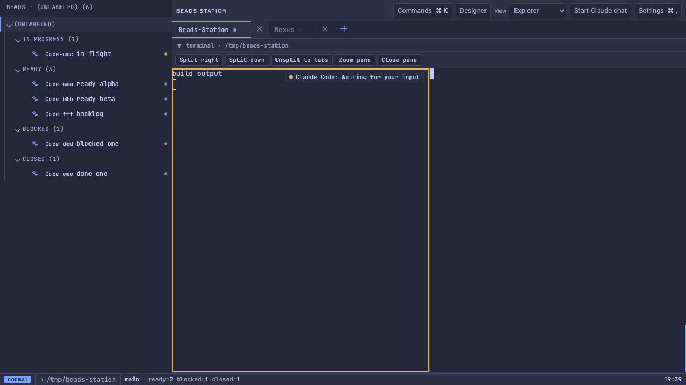
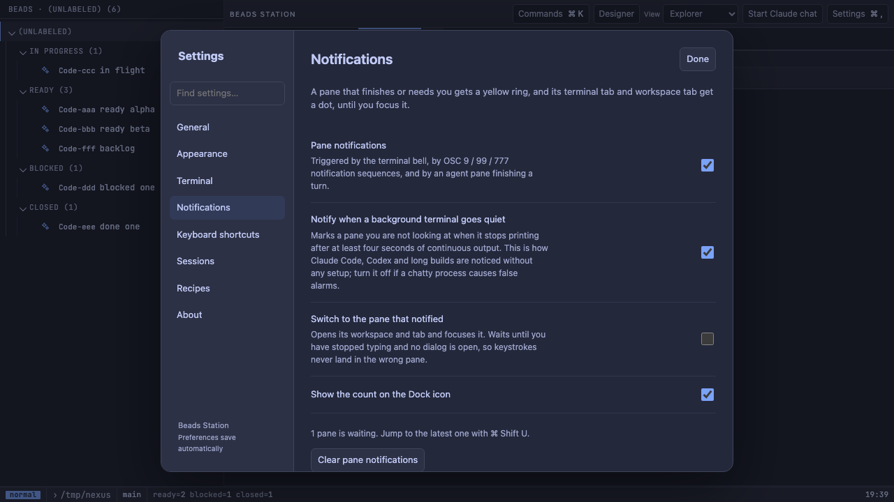
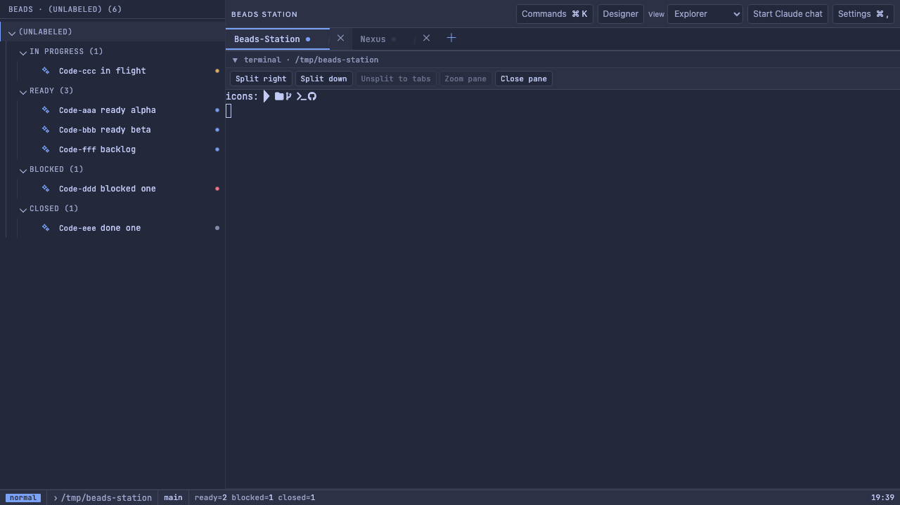
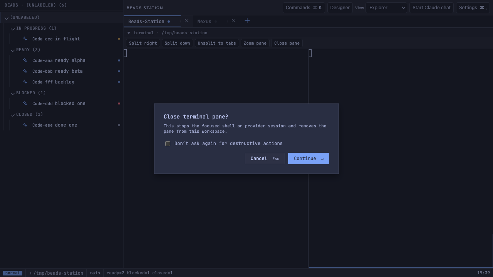
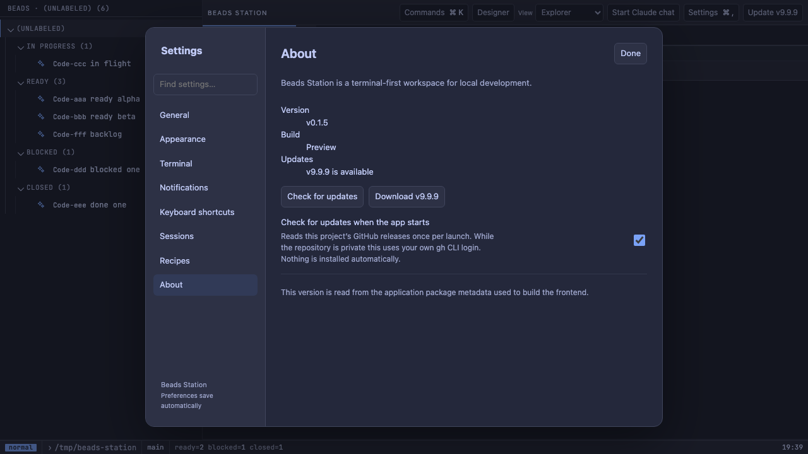

# Beads Station v0.1.5 — pane notifications and Designer conductor runs

Apple Silicon macOS preview. This patch adds pane notifications, macOS terminal editing shortcuts, bundled Nerd Font icons, a release check, and Enter-to-confirm dialogs. It also makes Designer runs through Codex work on the current Codex CLI and adds the Codex orchestrator conductor. The Designer is still not a finished workflow.

## Install or upgrade

Download `Beads.Station_0.1.5_aarch64.dmg` and its `.sha256` from this release.
Run `shasum -a 256 -c Beads.Station_0.1.5_aarch64.dmg.sha256`, quit the old app after saving work, open the DMG, and drag Beads Station to Applications. A saved layout does not keep running processes alive.
The app is ad-hoc signed, not Developer ID signed or notarized. If macOS blocks launch, right-click the app and choose Open, or allow it in Privacy & Security.

## Changes

### Terminal and daily use

- **Pane notifications.** A terminal or agent pane you are not looking at gets a yellow ring and a short message when it rings the bell, sends an OSC 9 / 99 / 777 notification, finishes an agent turn, or goes quiet after at least four seconds of continuous output (which is how Claude Code, Codex and long builds are noticed with no setup). Its terminal tab and workspace tab get a dot, and the Dock icon shows the count. Focusing the pane clears it. `Cmd+Shift+U` jumps to the latest one. Settings → Notifications can turn each part off, and can switch to the notifying pane automatically; that switch waits until you stop typing.
- **macOS editing shortcuts in terminals.** `Cmd+Left/Right` move to the start/end of the line, `Cmd+Backspace` deletes to the line start, `Cmd+Delete` to the line end, `Option+Delete` deletes the next word, `Cmd+Up/Down` scroll to the top/bottom, and `Shift+Enter` inserts a newline in Claude and Codex prompts. `Option+Left/Right`, `Option+Backspace` and Option-click to move the cursor already worked. Full-screen programs such as Neovim never receive the shell control codes. Settings → Terminal can turn the set off.
- **Nerd Font icons.** The app's WebView cannot see fonts installed in `~/Library/Fonts`, which is why LazyVim and prompt icons showed as boxes here but not in other terminals. JetBrainsMono Nerd Font now ships with the app and backs every terminal font choice.
- **Enter confirms.** In the close-pane, close-workspace and close-app confirmations, Enter confirms and Escape cancels; the confirming button has focus.
- **Fewer repeated lines after a resize.** Dragging a split or resizing the window used to send the shell dozens of resize signals, and Claude Code and Codex reprint their transcript on each one. The shell is now told once, when the size settles.
- **Resume an agent CLI after a restart.** When a restored terminal pane had Claude Code or Codex running, it offers **Start shell and resume** next to **Start new shell**. That runs `claude --continue` or `codex resume --last`, which reopens the latest conversation for that folder and uses no tokens until you send a message. Nothing is resumed without the click.
- **Release check.** Settings → About shows whether a newer release exists and can download its DMG to `~/Downloads`, verify the published SHA-256 and open it. The check runs once per launch (can be turned off) and on request. While the repository is private it reads releases through your own `gh` CLI login. Nothing is installed automatically.
- **Terminal scroll anchor.** Only your own scrolling or typing changes whether a terminal follows new output, so trimmed or reprinted output no longer pulls you back to the bottom.
- **Drop files onto a terminal.** Dropping files from Finder pastes their shell-quoted paths into the pane under the pointer.
- **Shortcut upgrades keep your choices.** A command added by an update no longer takes a shortcut you had already assigned to something else.

### Designer

- **Designer Codex runs start again.** `codex exec` 0.155 rejects `--ask-for-approval`, so every Designer run through Codex or the Codex orchestrator exited before its first model turn. Runs now set the approval policy through a config override (`-c approval_policy="never"`).
- **Designer conductor choice.** The request panel can run a ticket through Claude, Codex, or the `codex-orchestrator` conductor. The conductor needs `codex` and the adaptive-orchestrator skill in the workspace (`.agents/skills/…`) or globally (`~/.codex/skills/…`); a primary agent plans the work and hands implementation to one bounded worker. An `opus-conductor` entry is a detection-only placeholder and never starts.
- **Designer runs leave the ticket open for your review.** The run prompt tells the agent not to close the ticket; approval is recorded against that run's captured revision.
- **Resizable Designer columns.** The navigation and gates/agents columns can be dragged, moved with arrow keys, or reset with a double-click, and their widths persist.

### Build

- **Signed bundle passes strict verification.** The build now ad-hoc signs the whole app bundle, so `codesign --verify --deep --strict` passes without a manual re-sign.

## Known limits

- Nothing new in this release was exercised in the packaged app; see the checklist. That includes the Designer click-through (request → Start → review → capture → request changes → approve inside the WKWebView).
- "Quiet after work" is a heuristic. A process that prints steadily for a few seconds and then pauses (a dev server, a log tail) can raise a false notification; turn the option off if it does. System Notification Center alerts are not implemented (`Code-my5`).
- Resume reopens the latest conversation for the folder, not the exact one a pane had. Two agent panes in one folder resume the same conversation (`Code-6un.3.1`).
- The update check does not replace the app for you; that needs Developer ID signing (`Code-t3w.2`).
- Artifact capture includes `.beads/` tracker files when an agent claims a ticket (`Code-am5.7`). The Designer run view shows only the orchestrator's main thread, not its worker (`Code-am5.8`).
- Terminal processes still do not survive an app restart (`Code-6un.3`). LazyVim colors (`Code-0cp.4`), the chat view redesign (`Code-am5.5`) and durable conductor leases (`Code-yfb`) remain open.
- Apple Silicon only.

## Hands-on checklist

- Settings → About shows 0.1.5. Click **Check for updates**: it should report that you are up to date.
- Settings and shortcuts from 0.1.4 are still there after installing over it.
- Open LazyVim in a terminal pane: file-tree and statusline icons render instead of boxes.
- At a shell prompt, type a few words and try `Cmd+Left`, `Cmd+Right`, `Option+Left`, `Cmd+Backspace`. In Claude Code, `Shift+Enter` adds a line instead of sending. Option-click moves the cursor on the prompt line.
- Split a terminal. In the unfocused pane run `sleep 6; printf '\a'` and click the other pane: the first gets a yellow ring. Focus it and the ring clears.
- Start Claude Code or Codex in one terminal tab, give it a task, and switch to another tab: the first tab gets a dot when it finishes, and `Cmd+Shift+U` jumps to it. The Dock icon shows a count while the app is in the background.
- Turn on Settings → Notifications → **Switch to the pane that notified** and repeat: the app switches by itself once you stop typing.
- Click **Close pane**, then press Enter: the pane closes. Again, then Escape: it stays. `Cmd+Q`, then Escape: the app stays open.
- Drag a split seam back and forth while Claude Code or Codex is showing a transcript, then scroll up: the transcript should not be repeated once per drag step.
- With Claude Code running in a terminal pane, quit and reopen the app: that pane offers **Start shell and resume Claude**, and clicking it reopens the conversation.
- Designer: open a git workspace with a small ticket, choose **Codex orchestrator**, click Start work, and confirm the status moves from running to needs review. Then capture the artifact, check the diff preview, request a change, and approve the new revision.
- Confirm the agent left the ticket open, and that editing a file after capture blocks approval.
- Choose **Opus conductor**: it should be disabled or explain that it is a placeholder, and nothing should start.
- Drag the Designer columns, restart the app, and confirm the widths are kept.
- In a terminal streaming output (for example Claude or Codex), scroll up and confirm the view stays put; then drop a Finder file onto a pane.

## Verification

- Rust 127/127, plus two opt-in tests run once each: the live release check against the real release list (it found v0.1.4 and correctly ignored the unpublished draft), and the earlier live Designer run described below.
- Vitest 267/267. Playwright Chromium with mock IPC 88/88, twice in a row. Five existing specs that emitted events before the app had subscribed, and two that sampled restored state too early, failed on the unchanged code as well; they now wait for the reaction and pass reliably.
- The new behaviour is covered in the browser harness: ring and dots across panes, tabs and workspaces, auto-switch, Enter/Escape, the bytes each editing shortcut sends, the Nerd Font face loading and rendering icon glyphs, and the update check and download request.
- Production build, Tauri release build, and `git diff --check` passed. `codesign --verify --deep --strict` passes on the built app; its Info.plist reports 0.1.5.
- Real provider run (one, authorized, 2026-09-23): the opt-in Rust test `live_designer_run_reaches_review_and_binds_approval` started `codex-orchestrator` with the production spawn path on a scratch git repo containing one Beads ticket. The orchestrator claimed the ticket, delegated to a worker, changed exactly `index.html` and `styles.css` as requested, and exited in 107 s. The run reached `needs_review` and passed the reviewable-attempt gate. Artifact capture produced a revision whose hash was stable on recapture, and a later workspace change invalidated it. Reported usage: about 196k input tokens (172k cached) and 773 output tokens.
- Browser and mock checks do not prove packaged WKWebView behaviour: font rendering, the Dock badge, key handling and the DMG download have not been run in the installed app.

## Screenshots

These come from this build's frontend running in the Chromium test harness with mock data, not from the packaged app. The session that built the release cannot capture the screen.

SHA-256: `b76326caf296dfb160c35a9ecf80e2e8f0809dbff29f045f57d93c6e6d7d9a02`
